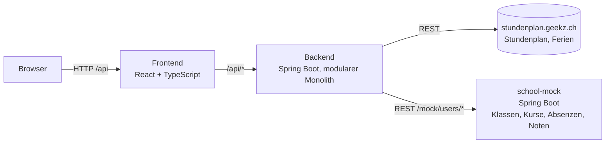
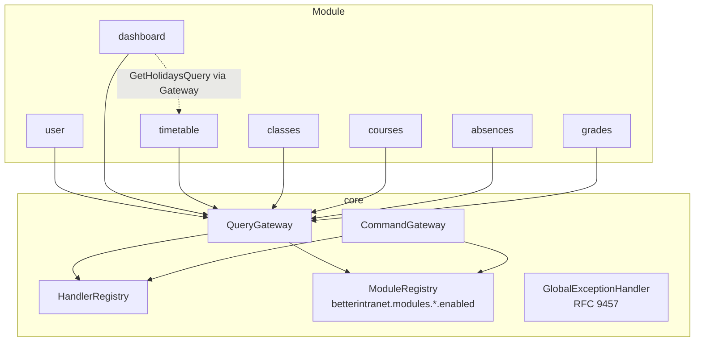
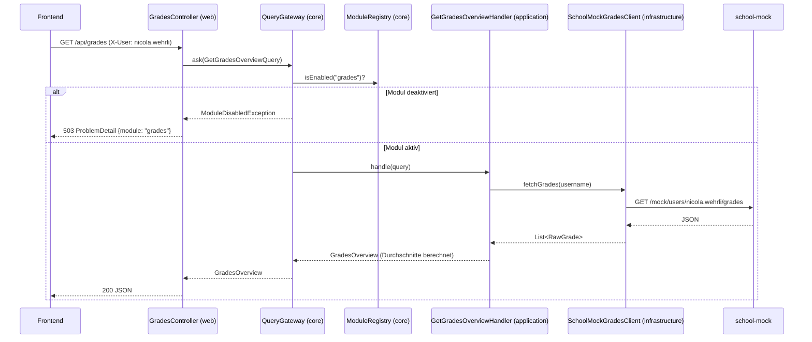

# Architektur

BetterIntranet besteht aus drei Deployables: dem React-Frontend, dem Spring-Boot-Backend als
**modularem Monolithen** und einem zweiten Spring-Boot-Service, der die Schulsysteme mockt.
Der Stundenplan ist die einzige echte externe Schnittstelle.

## Systemübersicht



## Module im Backend

Jedes fachliche Modul ist ein eigenes Java-Paket unter `ch.tbz.betterintranet`. Module kennen
sich nicht direkt. Sie kommunizieren nur über das **Command/Query Gateway** und die öffentlichen
`api`-Pakete. Das wird durch ArchUnit-Tests erzwungen.



| Modul       | Verantwortung                                             | Datenquelle                              |
|-------------|-----------------------------------------------------------|------------------------------------------|
| `core`      | Gateways, Modul-Schalter, Fehler-Mapping, `X-User`         | –                                        |
| `user`      | Profil des angemeldeten Benutzers                          | JSON im Classpath                        |
| `dashboard` | News, Termine, Prävention, Links                           | JSON + Ferien aus `timetable`            |
| `timetable` | Stundenplan, Klassen, Ferien                               | `stundenplan.geekz.ch`                   |
| `classes`   | Meine Klassen                                              | `school-mock`                            |
| `courses`   | Meine Kurse                                                | `school-mock`                            |
| `absences`  | Absenzen inkl. Zusammenfassung (nur Anzeige)               | `school-mock`                            |
| `grades`    | Noten inkl. gewichteter Durchschnitte und Zeugnisrundung   | `school-mock`                            |

## Schichten in einem Modul

```
grades/
├── api/            Queries + Result-Records, öffentlich
├── application/    QueryHandler (Use Case), Port-Interface zum Upstream
├── domain/         Fachlogik, z.B. GradeAverageCalculator
├── infrastructure/ HTTP-Client zum Upstream, Mapper, Cache
└── web/            REST-Controller, dünn, ruft nur das Gateway
```

Regeln (ArchUnit `ModuleBoundariesTest`):

- `web` ruft nur Gateways, nie `application` oder `infrastructure`.
- Module greifen auf andere Module nur über deren `api`-Paket zu.
- `core` kennt kein Modul.
- Handler liegen in `application`.
- Keine Zyklen zwischen Modulen.

## Ablauf einer Anfrage



## Abschalten und Ersetzen von Modulen

- **Abschalten:** `betterintranet.modules.grades.enabled=false` in `application.yml` oder als
  Umgebungsvariable `BETTERINTRANET_MODULES_GRADES_ENABLED=false`. Das Gateway lehnt alle Anfragen
  an das Modul mit 503 ab, `GET /api/modules` meldet `enabled: false` und das Frontend blendet den
  Navigationseintrag aus.
- **Ersetzen:** Das Noten-Modul holt seine Daten heute vom Mock. Für die echte Anbindung wird nur
  `SchoolMockGradesClient` durch eine andere Implementierung des Ports `GradesClient` ersetzt.
  Handler, Domain, Controller und Frontend bleiben unverändert.

## Frontend

```
frontend/src/
├── app/            Router, Layout (TopBar, MainNav, Breadcrumb), Modul-Registry, Provider
├── modules/        dashboard, timetable, classes, courses, absences, grades
├── shared/         API-Client, Typen, UI-Bausteine, Design-Tokens
└── test/           Vitest-Setup, MSW-Server und -Handler
```

Jedes Frontend-Modul exportiert eine `ModuleDefinition` (Name, Navigationseintrag, Routen). Die
Registry baut daraus Router und Navigation. Die Navigation zeigt nur Module, die `GET /api/modules`
als aktiv meldet; Routen deaktivierter Module zeigen eine Hinweis-Karte.

## Externe Schnittstelle: Stundenplan

| Zweck            | Endpoint                                                                                   |
|------------------|--------------------------------------------------------------------------------------------|
| Klassenliste     | `GET /api/rest/view/v1/timetable/filter?resourceType=CLASS&timetableType=STANDARD&start=…&end=…` |
| Lektionen        | `GET /api/rest/view/v1/timetable/entries?start=…&end=…&format=5&resourceType=CLASS&resources=<classId>&periodTypes=&timetableType=STANDARD&layout=START_TIME` |
| Ferien           | `GET /holidays`                                                                            |

Das Backend mappt `position1` (Lehrperson), `position2` (Fach), `position3` (Raum) auf ein
schlankes `Lesson`-Record und cached Antworten 5 Minuten (Caffeine). Fehler des Upstreams werden
als 502 mit `upstream: "timetable"` gemeldet. Echte Antworten liegen als Fixtures in
[`docs/fixtures`](fixtures) und werden in den WireMock-Tests verwendet.

## Fehlerformat

Alle Fehler sind RFC-9457-ProblemDetails:

| Fall                 | Status | `type`                                   | Zusatzfeld |
|----------------------|--------|------------------------------------------|------------|
| Modul deaktiviert    | 503    | `urn:betterintranet:module-disabled`     | `module`   |
| Nicht gefunden       | 404    | `urn:betterintranet:not-found`           | –          |
| Upstream nicht erreichbar | 502 | `urn:betterintranet:upstream-unavailable` | `upstream` |
| Interner Fehler      | 500    | `urn:betterintranet:internal`            | –          |
